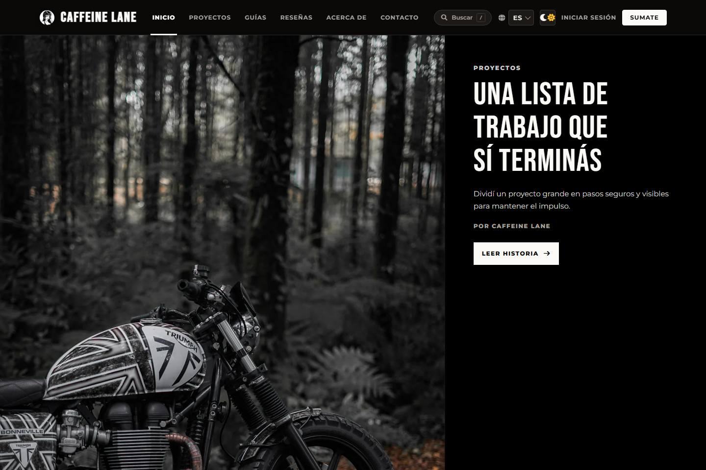
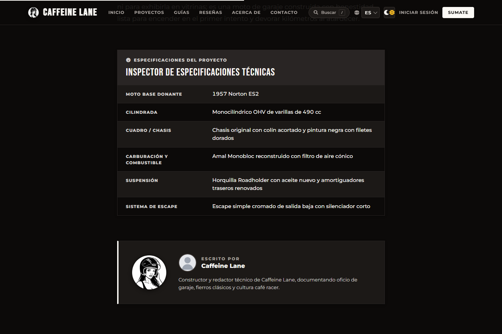
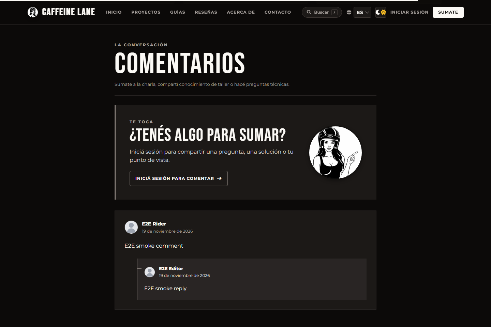
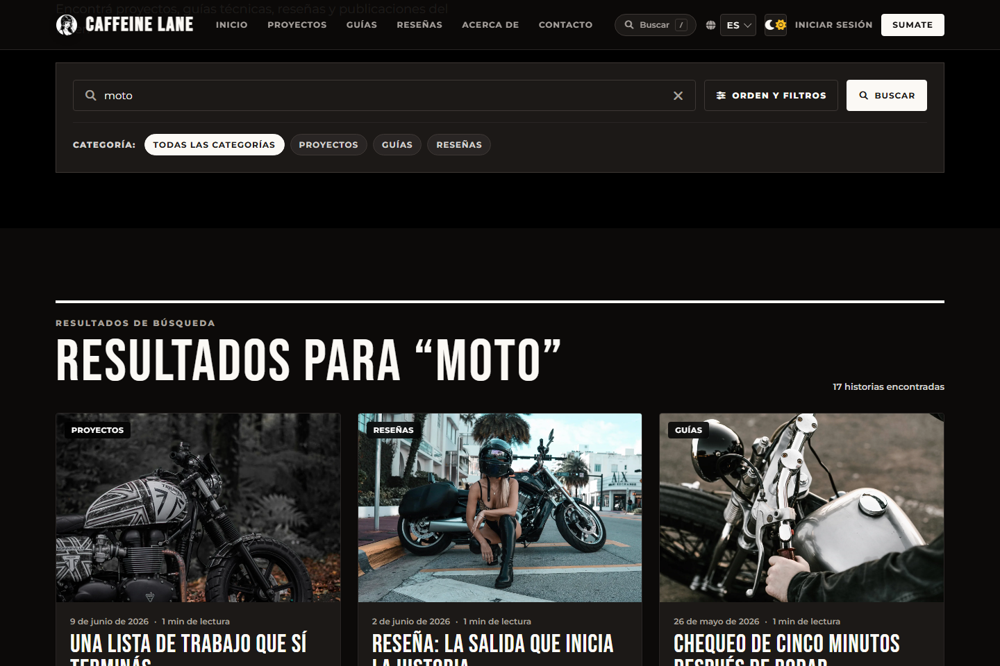
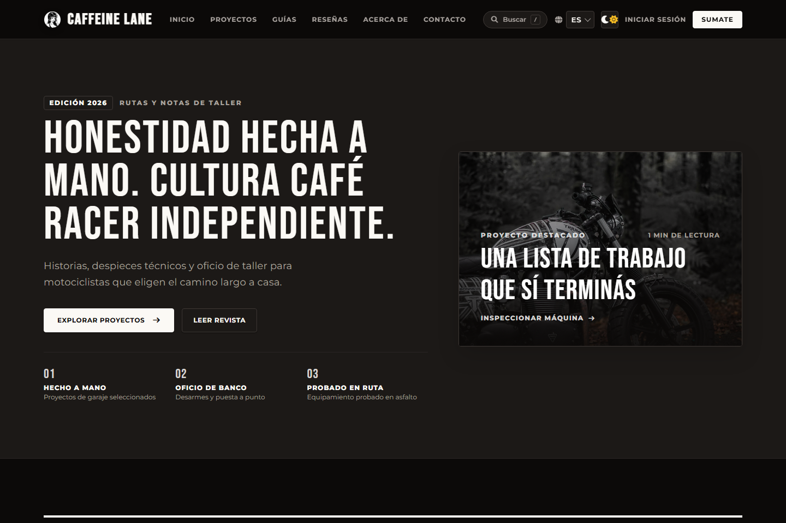

# Caffeine Lane

[](https://github.com/acevedo-daniel/caffeine-lane/actions/workflows/ci.yml)

> An independent editorial journal for cafe racer builds, workshop guides, reviews, and rider culture.

Caffeine Lane publishes long-form motorcycle build logs with technical specs, workshop guides, and reviews, plus reader discussions and an interface in Spanish and English. It is a server-rendered Django application rather than a social feed or a single-page app.

**[Open the live demo](https://caffeine-lane.vercel.app/)**

> [!NOTE]
> The live demo keeps password recovery disabled by default. Until a custom domain is verified in Resend, outbound transactional emails are restricted to sandbox recipients.

## Screenshots

### Editorial home



### Experience & community

| Article detail & build specs | Community discussion |
| --- | --- |
|  |  |

| Search & category filters | Public landing experience |
| --- | --- |
|  |  |

## Key capabilities

- **Editorial publishing:** Build logs, workshop guides, and reviews organized in three categories (`builds`, `guides`, `reviews`), with validated image uploads and motorcycle spec sheets.
- **Search:** Weighted PostgreSQL full-text search ranked by relevance, with category filters that persist across pagination.
- **Reader community:** Email-based accounts, rider profiles with avatars, and comment threads limited to one reply level so discussions stay readable.
- **Bilingual interface:** Spanish and English through Django's gettext translations.
- **Reading experience:** A reading progress indicator and dark mode that follows the system preference, without a client-side framework.

## Engineering highlights

- **Server-rendered by design.** Django templates, Tailwind CSS, and small vanilla JavaScript modules render pages on the server instead of shipping a single-page app, which keeps the client light and the rendering logic in one place.
- **Email-first identity.** The custom `accounts.User` model uses email as the primary identifier from the start, with Argon2 password hashing in production.
- **PostgreSQL search with a local fallback.** Production queries use PostgreSQL `SearchVector` and `SearchRank` with weights across titles, excerpts, and content; local development without PostgreSQL falls back to SQLite `icontains`.
- **Discussion rules in a service layer.** Comments are validated in a service layer before they are saved. Replies are capped at one level, and withdrawn and moderator-hidden comments have explicit states.
- **Separate database connections.** Web requests use Neon's pooled connection, while migrations run over a direct, unpooled connection to avoid transaction-pooling issues.

## Architecture

```text
Browser -> Vercel CDN / Django function (Python 3.14)
                  -> Neon PostgreSQL (pooled runtime / direct migrations)
                  -> Cloudinary (user & editorial media)
                  -> Resend (transactional email)
```

Django owns routing, authentication, form validation, business rules, and template rendering. Static assets are compiled to minified CSS and ES modules and served from Vercel's CDN.

## Technology stack

- **Backend:** Python 3.14, Django 6, PostgreSQL, and Gunicorn.
- **Frontend:** Django Templates, Tailwind CSS 4, and vanilla JavaScript.
- **Services:** Neon, Cloudinary, Resend via Anymail, WhiteNoise, and Vercel.
- **Tooling:** uv, pnpm, Pytest, Playwright, Ruff, Docker, and GitHub Actions.

## Repository structure

| Path | Responsibility |
| --- | --- |
| `apps/accounts` | Custom user model, authentication, registration, profiles, and password flows. |
| `apps/core` | Landing/home surfaces, contact flow, image validation, and health endpoints. |
| `apps/posts` | Editorial content, taxonomy, search, comments, moderation, and publishing behavior. |
| `config/settings` | Base, local, test, and production Django settings. |
| `docker/` | Production container startup and migration orchestration. |
| `static/` | Authored frontend source and compiled distribution assets. |
| `templates/` | Shared server-rendered layouts and page templates. |
| `tests/` | Frontend asset tests and Playwright browser tests. |

## Local development

Prerequisites: Python 3.14+, uv, Node.js 22, pnpm 10, and Docker Compose.

```bash
# 1. Setup environment and database container
cp .env.example .env
docker compose up -d db

# 2. Install dependencies and compile assets
uv sync --locked
pnpm install --frozen-lockfile
pnpm run build

# 3. Verify baseline, run migrations, and seed editorial content
uv run python manage.py check_fresh_baseline
uv run python manage.py migrate
uv run python manage.py seed_editorial
```

> On Windows PowerShell, use `Copy-Item .env.example .env`.

Start the frontend asset watcher in one terminal:

```bash
pnpm run dev
```

Run Django in another terminal:

```bash
uv run python manage.py runserver
```

Open [`http://localhost:8000`](http://localhost:8000) to browse the journal locally.

## Quality

```bash
# Linting, formatting, and Django system checks
uv run ruff check .
uv run ruff format --check .
uv run python manage.py check
uv run python manage.py makemigrations --settings=config.settings.test --check --dry-run

# Backend tests with coverage
uv run pytest

# Build frontend assets and run module unit tests
pnpm run build
pnpm test

# Browser smoke tests with Playwright
pnpm run test:e2e
```

CI runs the Quality, Tests, E2E, Production, and Docker jobs,
then exposes one stable CI Gate check for the protected main branch. The suite
uses PostgreSQL 18 on Python 3.14, validates production settings, builds and
tests frontend assets, runs Playwright browser smoke tests, and verifies the
production Docker container.

## Documentation

- [Project & Domain](docs/PROJECT.md): Scope, user personas, editorial rules, and provenance.
- [Architecture](docs/ARCHITECTURE.md): System topology, component boundaries, invariants, and trade-offs.
- [Development Workflow](docs/DEVELOPMENT.md): Local environment, database commands, and asset pipeline.
- [Testing Strategy](docs/TESTING.md): Testing strategy, test layers, and quality gates.
- [Deployment Guide](docs/DEPLOYMENT.md): Hosting topology, Vercel runtime contract, and release pipeline.

## License

[MIT](LICENSE)
